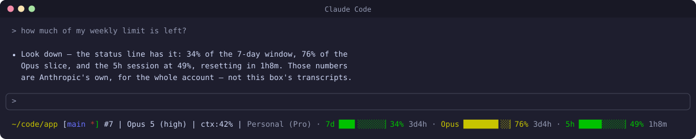
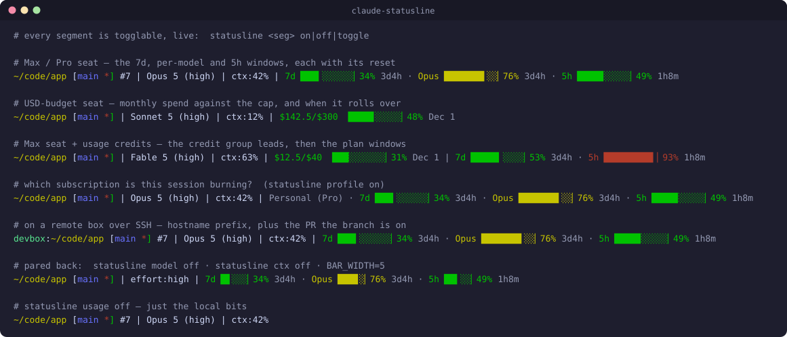
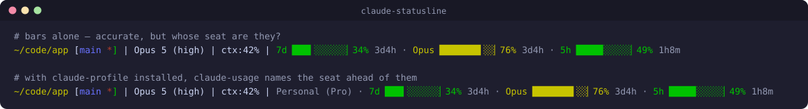

# claude-statusline

A status line for [Claude Code](https://claude.com/claude-code) with **account-usage bars straight from Anthropic's own server-side counter** — plus live-togglable segments, controlled from your shell or from inside Claude Code via a `/sl` slash command.

<p align="center">
  
</p>

(The status line row is genuine output — `tools/generate-readme-svg.zsh` seeds
demo caches and pipes Claude Code's own statusline JSON through
`statusline-command.sh`, then converts the ANSI colours to SVG. Only the window
and the conversation above it are drawn. Bars are green / amber / red by fill.)

- **Usage bars show what Anthropic bills, not what ran locally.** The `claude-usage` component reads the same OAuth usage endpoint that claude.ai → Settings → Usage shows, covering *all* usage on the account (Claude Code on any machine + claude.ai) — unlike transcript-based tools that only see the current box. Works for both plan shapes: USD-budget seats render `$300.04/$300 ▕████▏100%`, Max/Pro seats render their 7d/model/5h rate-limit windows.
- **Never blocks your prompt.** The statusline only ever reads a cache; refreshes happen in a detached background process with stale-while-revalidate semantics, failure backoff, and lock-guarded fetches.
- **Every segment is togglable, live.** `statusline usage off` (or `/sl usage off` inside Claude Code) hides a segment on the next repaint — no restart, no settings edit.
- **`claude-usage` is also a standalone CLI**: colour bars, plain text, or JSON for scripts.

## Segments

| Segment | Shows | Toggle key |
|---|---|---|
| cwd | working directory (`~`-shortened) | always on |
| `host` | hostname prefix — Linux only (for SSH'd sessions) | `CLAUDE_STATUSLINE_HOST` |
| `git` | branch + red `*` dirty marker | `CLAUDE_STATUSLINE_GIT` |
| `pr` | PR number, right after the branch (`[main *] #7`); an OSC 8 hyperlink when the terminal supports it | `CLAUDE_STATUSLINE_PR` |
| `model` | model display name | `CLAUDE_STATUSLINE_MODEL` |
| `effort` | session reasoning effort, after the model name (`Opus (high)`), or `effort:high` with `model` off; absent when the model has no effort parameter | `CLAUDE_STATUSLINE_EFFORT` |
| `ctx` | context-window used % | `CLAUDE_STATUSLINE_CTX` |
| `cache` | prompt-cache countdown: time until the conversation's cache goes cold (`cache:52m07s`, or the time it goes cold, `cache:until 14:32`; see [cache format](#cache-format); green → amber → red as it nears expiry), then `cache:cold 180k` with the tokens the next turn re-caches. A cold cache makes the next turn re-process the whole context, so this is a nudge to keep momentum. Read from Claude Code's own `prompt_cache` data (v2.1.251+), so it's exact, not estimated from the transcript. **Opt-in** (off by default) | `CLAUDE_STATUSLINE_CACHE` |
| `usage` | account spend / rate-limit bars | `CLAUDE_STATUSLINE_USAGE` |
| `reset` | 5h-session reset countdown (rendered inside `usage`; absent on Ultra, which has no 5h window) | `CLAUDE_STATUSLINE_RESET` |
| `budget` | daily budget on the monthly `$`-cap — what's left ÷ days until it resets, today included (`$300` cap, `$142.50` spent, 11 days left → `$14.32/day`); recalculated on every refresh, so it drops as you spend during the day ([how it's calculated](https://github.com/deviationist/claude-usage#daily-budget)). **Opt-in** (off by default); rendered inside `usage`, only where a `$`-cap is | `CLAUDE_STATUSLINE_BUDGET` |
| `profile` | seat label (`Personal (Pro)`) ahead of the bars — needs [claude-profile](https://github.com/deviationist/claude-profile) | `CLAUDE_STATUSLINE_PROFILE` |

Every row below is a real render, one per plan shape and toggle combination:

<p align="center">
  
</p>

### Which subscription am I burning? (`profile`)

With several Claude subscriptions on one machine, the bars alone don't say
*whose* they are. If the companion
[**claude-profile**](https://github.com/deviationist/claude-profile) juggler is
installed, the seat is named ahead of them:

<p align="center">
  
</p>

It is **on by default but self-disabling**: the statusline asks `claude-usage`
for a label, `claude-usage` asks `claude-profile` once — by the session's
config dir, not the cwd — and caches the answer. With no juggler installed, or
none that claims the dir, nothing is rendered and nothing is said. So there's
no flip to remember on a machine that has it, and no cost on one that doesn't.
`statusline profile off` refuses it outright.

The name and its casing come from claude-profile's own config (`display` /
`account_display`), not from here. It names only what actually varies on the
machine: with one profile and several subscriptions you get `Ultra` (the
profile name would be a constant), with several profiles you get
`Personal (Ultra)`, and with a single profile holding a single subscription
you get nothing at all — there'd be nothing to tell apart.

## Install

Requirements: `zsh`, `jq`, `curl`. (The statusline script itself is POSIX `sh`; zsh is used for the toggle helper and the usage fetcher.)

### With Claude Code

Paste this into Claude Code:

> Set up claude-statusline for me. Clone https://github.com/deviationist/claude-statusline
> into the folder where I keep my git repos (ask me if you're not sure), run its
> `install.sh --dry-run` and show me what it would change. When I say yes, run
> `install.sh`.

### With the installer

From the folder where you keep your git repos:

```sh
git clone https://github.com/deviationist/claude-statusline.git
claude-statusline/install.sh --dry-run   # show what would change
claude-statusline/install.sh
```

The installer sets up the recommended configuration, the one the author runs
day to day:

- **`statusLine` in `settings.json`**, repainting every second
  (`refreshInterval: 1`) so the cache countdown ticks. That's cheap: the slow
  segments are cached (see [caching](#caching)).
- **[claude-usage](https://github.com/deviationist/claude-usage)** cloned next
  to this repo, for the usage bars.
- **The `budget` and `cache` segments switched on.** Both are off by default.
  `budget` only shows on accounts with a monthly `$`-cap.
- **The `/sl` slash command** linked into the config dir.
- **The `statusline` and `claude-usage` shell commands** sourced from `~/.zshrc`.

Every step checks first and skips what's already done, so re-running is safe.
Helpers you already source, from `~/.zshrc` or from a file it sources, aren't
added again.
`settings.json` is backed up before it's changed, and a segment you've already
switched on or off keeps your choice. It sets up `$CLAUDE_CONFIG_DIR` or
`~/.claude`, or every profile dir if you use
[claude-profile](https://github.com/deviationist/claude-profile).

| Flag | Effect |
|---|---|
| `--dry-run` | Show what would change, change nothing |
| `--minimal` | Plain defaults: `budget` and `cache` off, `refreshInterval: 60` |
| `--config-dir DIR` | Set up this config dir instead (repeatable) |
| `--no-usage` | Don't clone claude-usage (no usage bars) |
| `--no-shell` | Don't touch `~/.zshrc`; print the lines to add instead |

Afterwards, restart open Claude Code sessions and open a new shell.

### By hand

The account-usage bars are provided by the companion
[**claude-usage**](https://github.com/deviationist/claude-usage) project. Clone
it as a **sibling** of this repo and the statusline finds it automatically; skip
it if you don't want the usage segment (everything else still works).

```sh
git clone https://github.com/deviationist/claude-statusline.git ~/code/claude-statusline
git clone https://github.com/deviationist/claude-usage.git       ~/code/claude-usage   # optional: usage bars
```

1. **Statusline** — in `~/.claude/settings.json`:

   ```json
   "statusLine": {
     "type": "command",
     "command": "bash /ABSOLUTE/PATH/TO/claude-statusline/statusline-command.sh",
     "refreshInterval": 60
   }
   ```

   `refreshInterval` is worth setting. Without it Claude Code repaints only
   when something happens in the session, so anything that arrives *after*
   the first paint — a usage cache warmed in the background, a seat label
   resolved on its first run — sits invisible until you send a message. With
   it, the line fills itself in. Every segment reads from a cache and the
   whole render is local, so a 60-second repaint costs nothing.

   With the `cache` segment on, a relative countdown only moves on a
   repaint, so for ticking seconds set `refreshInterval` to `1`. That's
   cheap: the slow segments are cached (see [caching](#caching)), so a
   repaint costs about 20 ms. If you'd rather keep 60, use a minutes-only
   format or the `clock` style (see [cache format](#cache-format)). Claude
   Code also repaints the moment the cache expires, so `cold` shows up on
   time either way.

2. **Shell helpers** — in `~/.zshrc`:

   ```sh
   source ~/code/claude-statusline/statusline.zsh     # statusline toggle helper
   source ~/code/claude-usage/claude-usage.zsh        # claude-usage CLI (optional, from the sibling repo)
   ```

   The statusline locates `claude-usage.zsh` automatically when the
   `claude-usage` repo is cloned next to this one. If you keep it elsewhere,
   point `CLAUDE_USAGE_SCRIPT` at the file (e.g. in `settings.json`'s `"env"`).

3. **`/sl` slash command** (optional) — symlink it into Claude Code's commands dir:

   ```sh
   mkdir -p ~/.claude/commands
   ln -sf ~/code/claude-statusline/commands/sl.md ~/.claude/commands/sl.md
   ```

   (Named `/sl` because `/statusline` is a Claude Code built-in.)

## Toggling segments

```sh
statusline                  # list all segments with their current state
statusline usage off        # hide the account-usage bars
statusline reset toggle     # flip the 5h reset countdown
statusline model off        # hide the model name
statusline budget on        # opt in to the $-cap daily budget ("$14.32/day")
statusline cache on         # opt in to the prompt-cache countdown ("cache:52m07s")
```

Inside Claude Code: `/sl`, `/sl usage off`, `/sl reset toggle`, …

State is stored as plain `NAME=value` lines in `${XDG_CONFIG_HOME:-~/.config}/claude-statusline/config` (override the path with `$CLAUDE_STATUSLINE_CONFIG`). The statusline re-sources it on every repaint, so changes apply immediately to running sessions. The config can also set:

```sh
CLAUDE_STATUSLINE_BAR_WIDTH=10   # cells per usage bar
CLAUDE_STATUSLINE_SEP=" · "      # separator between usage bars
```

### Caching

Claude Code re-runs the whole status line script on every repaint and
keeps no cache of its own. So the slow segments cache their own output,
nested: Anthropic's API → claude-usage's cache (~120 s) → the status line's
cache → the line. Only the cheap parts (the `cache` countdown, model, ctx)
are recomputed on every paint. A repaint drops from ~200 ms to ~20 ms.

```sh
CLAUDE_STATUSLINE_GIT_TTL=5      # seconds to reuse the git segment
CLAUDE_STATUSLINE_USAGE_TTL=30   # seconds to reuse the usage segment
```

`0` recomputes that segment on every repaint. A cached git segment can
trail a change by up to its TTL (the `*` dirty marker, a branch switch).
A cached entry is only reused for the same inputs: a new cwd or a toggle
flip renders fresh. Files live per session in
`$TMPDIR/claude-statusline-$USER/` (override with
`$CLAUDE_STATUSLINE_MEMO_DIR`), a few hundred bytes each. Once an hour the
status line deletes the ones untouched for a day, so ended sessions don't
pile up. It only deletes its own files, so the override can point at a folder
other things use too.

### Cache format

How the `cache` segment reads while the cache is warm. Two config values:

```sh
CLAUDE_STATUSLINE_CACHE_STYLE=relative     # time left (default) | clock: when it goes cold
CLAUDE_STATUSLINE_CACHE_FORMAT='%mm%ss'    # format for that style
```

| Style | Format | Shows |
|---|---|---|
| `relative` | `%mm%ss` (default) | `cache:52m07s` |
| `relative` | `%mm` | `cache:52m` (minutes only: fine with `refreshInterval` 60) |
| `relative` | `%M:%s` | `cache:52:07` |
| `clock` | `until %H:%M` (default) | `cache:until 14:32` |
| `clock` | `%H:%M:%S` | `cache:14:32:05` |

`relative` tokens: `%m` minutes, `%M` minutes two-digit, `%s` seconds two-digit, `%t` total seconds, `%%` a literal `%`. `clock` takes any `strftime` format, in local time. The colour (green → amber → red) and `cold` work the same in both styles.

Anything the config doesn't set falls back to the same-named process environment variable (e.g. from `settings.json`'s `"env"` block — restart-bound), then defaults to shown.

## How it fits with claude-usage and claude-profile

Three repos, each useful on its own. None strictly needs another; each one
you add switches on more of the line:

```
claude-statusline ──usage bars──▶ claude-usage ──seat label, --all──▶ claude-profile
                                       ▲                                    │
                                       └──── warms its cache on launch ─────┘
```

| Install | What you get |
|---|---|
| claude-statusline | cwd, git branch + PR, model, effort, context %, cache countdown |
| + [claude-usage](https://github.com/deviationist/claude-usage) | the usage bars, with the `reset` and `budget` segments inside them. Also a `claude-usage` command for the terminal |
| + [claude-profile](https://github.com/deviationist/claude-profile) | the `profile` seat label (`Personal (Pro)`), and bars that stay right after an account swap. Only worth it if you switch between several Claude subscriptions |

So most people want claude-statusline + claude-usage, which is what
[the installer](#with-the-installer) sets up. claude-profile doesn't need the
statusline either: it's a `claude` wrapper, and when claude-usage is loaded it
refreshes its cache at launch and after a swap so the bars are current.

claude-usage is a standalone tool with its own CLI (`--text-only`, `--json`,
`--raw`, `--dir`, per-account tokens, stale-while-revalidate caching); see
its repo for full docs. The statusline just calls it in `--no-block` mode.

## Caveats

- The usage endpoint (`api.anthropic.com/api/oauth/usage`) is **undocumented** and was reverse-engineered from Claude Code's own traffic. It may change or disappear without notice.
- Keep the TTL sane — hammering the endpoint gets rate-limited. The defaults are tuned for a statusline that repaints often.
- The tool only *reads* with the token Claude Code already stores locally; nothing is sent anywhere except the standard Anthropic API host.

## Tests

```sh
sh test/run.sh
```

Hermetic: a fake `$HOME`, a scratch git repo and a stub claude-usage under a
temp dir, each command run under `env -i`, no network. It covers the rendered
line (segment order, PR link, toggles), the memo cleanup (what it deletes and
keeps, the hourly gate, exit status) and the installer (dry run, re-runs,
kept choices, `--minimal`, profile dirs, broken input). CI runs it on Linux
and macOS.

## License

MIT — see [LICENSE](LICENSE).
